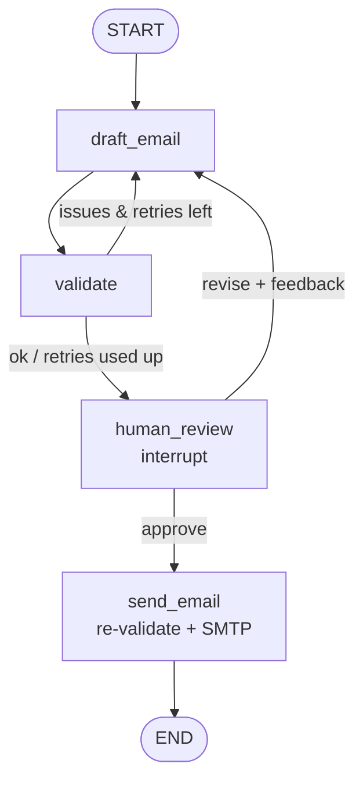

# Email Approval Agent (LangGraph + FastAPI + Streamlit)

A human-in-the-loop email agent. An LLM drafts the email, code validates it, **a human approves it**, and only then is it sent over SMTP.

## Flow



## Features
- **Human-in-the-loop** with LangGraph `interrupt()` / `Command(resume=...)`
- **Rewrite loop**: the draft is regenerated using your feedback
- **Guardrails**: placeholders (`[Name]`), missing subject or sign-off and wrong weekdays are caught and auto-retried; `send_email` validates again even after approval
- **Dates computed in code**, so the LLM cannot hallucinate weekdays
- **Persistent state**: SQLite checkpointer, pending approvals survive server restarts
- **Real SMTP** (Gmail App Password) with retry and backoff, plus a `DRY_RUN` mode
- **FastAPI** endpoints with input validation, and a **Streamlit** UI
- **Tests**: 12 tests using a fake LLM (no API key needed)

## Quick start
```bash
git clone https://github.com/MratunjaiSingh/email_approval_agent.git
cd email_approval_agent
python -m venv .venv
.venv\Scripts\activate                              # Windows
pip install -r requirements.txt
pip install langchain-groq                          # or your provider's package
copy .env.example .env                              # then fill in your keys
python run.py                                       # starts API + UI, opens the browser
```
## Sending real emails
1. Turn on 2-Step Verification for your Gmail account and create an App Password.
2. In `.env` set `DRY_RUN=false`, `SMTP_USER=<your gmail>` and `SMTP_PASSWORD=<app password>`.
3. Restart `python run.py`. Test with your own address first.

## API
```bash
# 1) create a draft (the graph pauses for approval)
curl -X POST localhost:8000/drafts -H "Content-Type: application/json" -d '{
  "query": "medical leave request, simple email",
  "to_email": "manager@example.com",
  "sender_name": "Your Name",
  "start_date": "2026-11-02",
  "end_date": "2026-11-06"
}'

# 2a) ask for a rewrite
curl -X POST localhost:8000/drafts/<thread_id>/resume -H "Content-Type: application/json" \
  -d '{"decision":"revise","feedback":"shorter and more formal"}'

# 2b) approve (this sends the email)
curl -X POST localhost:8000/drafts/<thread_id>/resume -H "Content-Type: application/json" \
  -d '{"decision":"approve"}'

# status
curl localhost:8000/drafts/<thread_id>
```

## Design decisions
| Decision | Why |
|---|---|
| `llm` and `mailer` are injected into `build_graph()` | Tests use fakes, and switching providers is easy |
| Nodes return partial dicts | Checkpointer-safe, no parallel-write conflicts |
| Validation runs again in `send_email` | An invalid draft is never sent, even after approval |
| SQLite checkpointer | State survives restarts (Postgres for production) |
| Dates and weekdays computed in code | Removes a whole class of LLM hallucinations |

## Limitations / next steps
- No authentication or rate limiting
- Single sender (`SMTP_USER`)
- Postgres checkpointer, Docker Compose, Gmail API (OAuth) option
